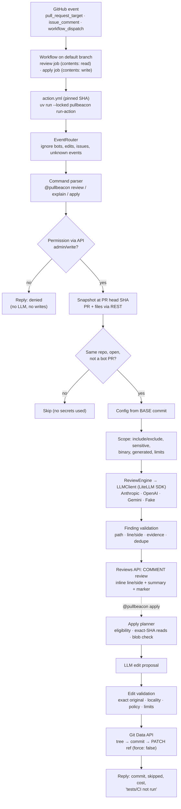

# Architecture

## Overview

## Trust boundary

| Trusted | Untrusted |
|---|---|
| Workflow file and `.pullbeacon.yml` on the default/base branch | PR diff, files, title, body, branch names |
| PullBeacon code at the pinned action SHA and its lockfile | Comments and their authors (until the API confirms permission) |
| GitHub API responses about permissions, SHAs, refs | Every LLM response |
| Reviews authored by the bot identity, bound to their `commit_id` | Markers found anywhere else |

## Components (`src/pullbeacon/`)

| Module | Responsibility |
|---|---|
| `config.py` | Versioned strict schema, safe globs, defaults, config hash |
| `domain/` | Immutable contracts (`PullRequestSnapshot`, `Finding`, `ReviewReport`, `RunResult`, …) and errors |
| `adapters/github.py` | REST client: versioned headers, bounded retries, host-restricted pagination, exact-SHA reads, permissions, Git Data |
| `adapters/llm.py` | `LLMClient` protocol; `LiteLLMClient` (no tools, own retries, schema fallback, cost); `FakeLLMClient` |
| `adapters/publisher.py` | Review/comment publishing, 422 degradation, trusted-review discovery, idempotency |
| `adapters/git_commit.py` | One fast-forward commit with ref re-checks |
| `core/diff.py`, `core/scope.py` | Patch parsing to real line numbers; what is reviewed and why the rest is skipped |
| `core/review.py`, `core/findings.py` | Batching, cost guard, JSON retry; deterministic validation |
| `core/markers.py`, `core/render.py` | State markers; sanitized Markdown |
| `core/explain.py`, `core/apply.py` | Explain; edit eligibility and validation |
| `orchestration/` | Command parser, event router, flows (review/explain/apply), action runner |
| `evaluation/` | Dataset, matching, metrics, reports |
| `testing/fake_github.py` | In-memory GitHub used by tests, fixture CLI mode and evaluation |

## Review flow

1. Route the event; ignore anything that is not a handled event or command.
2. For commands: verify write permission through the API; deny on any doubt.
3. Fetch the PR and its files; pin everything to `head.sha` (never `GITHUB_SHA`).
4. Reject forks, closed and bot PRs without calling the LLM.
5. Load config from the base commit; check idempotency (automatic: commit + config + prompt
   version; manual: comment id).
6. Select scope, batch deterministically, call the LLM with the diff rendered as line-addressed data.
7. Validate findings; publish one `COMMENT` review with inline comments on valid lines; if GitHub
   rejects them (422), publish the summary with the findings listed as not posted inline.

## Apply flow and safe refusal

`apply` proceeds only if every step passes; otherwise it replies with the reason and changes nothing:
apply job + write permission → same-repo open PR → `apply_enabled` → a trusted review **for the
current head** → eligible findings (confidence, new-side line, allowed and not denied paths, file
in the PR) → file content fetched at the head SHA whose git blob id matches → LLM proposal →
validation (exact original text, locality, no overlaps/placeholders/credentials, proportional,
limits) → permission re-check → branch not protected and still at the head SHA → tree + commit →
ref still at head SHA → `PATCH` with `force: false` → verify ref.

## LLM adapters

LiteLLM's Python SDK is used directly (no proxy, no database). Structured output uses
`response_format: json_schema` when LiteLLM reports support, falling back to JSON text with the
same validation. Provider-specific differences (parameter support, schema handling) are absorbed by
`drop_params=True` and the fallback; costs come from the bundled LiteLLM cost map.
